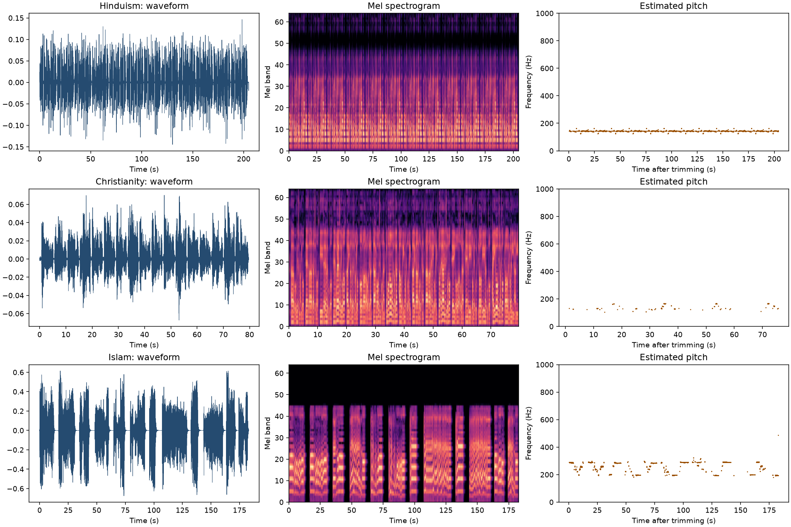

# Acoustic pattern report

Three recordings were analyzed after trimming leading and trailing silence.
The mel-profile similarity compares each recording's average distribution of
energy across mel-frequency bands. Higher values indicate more similar broad
spectral profiles; they do not mean the recordings sound identical.

## Feature summary

| Tradition | Duration | Median pitch | Pitch range | Voiced frames | Mean RMS energy | Spectral centroid | Spectral flatness | Onsets |
|---|---:|---:|---:|---:|---:|---:|---:|---:|
| Hinduism | 204.90 s | 143.41 Hz | 1.00 st | 30.78% | 0.02 | 1159.65 Hz | 0.00 | 2.23 /s |
| Christianity | 79.67 s | Not estimated | Not estimated | 4.90% | 0.01 | 2069.17 Hz | 0.02 | 2.41 /s |
| Islam | 182.97 s | 285.17 Hz | 7.00 st | 27.36% | 0.10 | 1136.25 Hz | 0.00 | 0.45 /s |

## Broad spectral-profile similarity

| Recording A | Recording B | Cosine similarity |
|---|---|---:|
| Hinduism | Christianity | 0.64 |
| Christianity | Islam | 0.60 |
| Hinduism | Islam | 0.45 |

## Quality notes

- **Christianity:** Reliable pitch could not be estimated

## Visualization

## Interpretation

These measurements describe these three files only. RMS energy depends on
recording gain and is not a loudness comparison. A single recording for
each tradition cannot show that a sound pattern is characteristic of a
religion. Performer, language, melody, room acoustics, microphone, and
recording quality can all affect the measurements. Pitch estimates may also
be unreliable for polyphonic, noisy, or strongly reverberant recordings.
